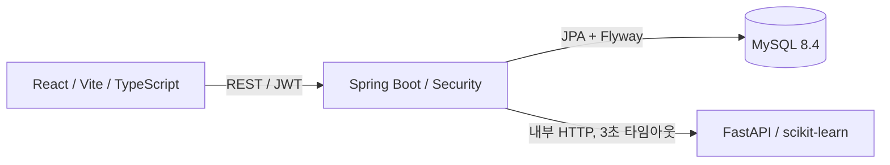

# 시스템 구조

Controller는 HTTP 입력을 검증하고 Service를 호출합니다. Service는 트랜잭션과 도메인 규칙을 담당하며 Repository가 JPA로 SQL을 실행합니다. DTO만 응답하여 엔티티 재귀 직렬화와 비밀번호 노출을 방지합니다.
예: GET /api/horses → CatalogController.horses → CatalogService.horses → HorseRepository.findByNameContainingIgnoreCase → MySQL → Page DTO.
인증: 로그인 시 BCrypt 비교 → JWT(서명, sub, jti, 만료) 발급 → 요청의 Bearer 토큰을 JwtFilter에서 검증 → DB의 로그아웃 토큰 여부 확인 → SecurityContext의 회원 ID로 즐겨찾기 소유자 결정. 클라이언트가 회원 ID를 지정하지 않습니다.
JWT는 브라우저 메모리에만 유지합니다. 새로고침하면 재로그인이 필요합니다. 로그아웃 시 서버 DB에 jti를 보관하여 토큰 재사용도 거부합니다.

후속 개선: `PredictionFeatures`가 읽기 transaction 안에서 출주마와 과거 전적을 일괄 조회한 뒤 불변 입력을 반환합니다. `PredictService`는 transaction 밖에서 FastAPI를 호출하므로 원격 응답 대기 중 DB 연결을 점유하지 않습니다. `HorseRepository`는 부모 두 관계를 EntityGraph로 함께 조회합니다. 운영 배포는 `compose.production.yaml`의 Caddy가 HTTPS를 종단하고 프론트 Nginx가 API 전달 및 인증 요청 제한을 담당합니다.
