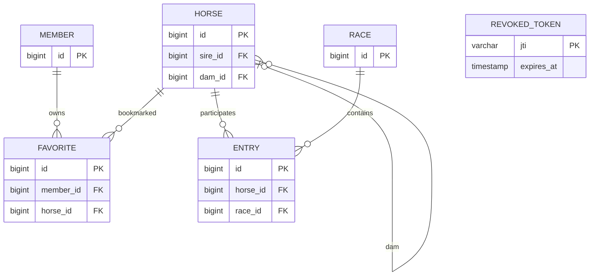

# 관계와 무결성

착순, 마번, 기수, 주파기록은 Horse가 아닌 Entry에 속합니다. (race_id, horse_id), (race_id, number), (member_id, horse_id), member.email에 UNIQUE를 둡니다. 말 부모는 nullable 자기 참조 FK이며 삭제는 RESTRICT입니다. 관리용 삭제 API는 제공하지 않습니다. 경주 개최일과 말 이름 인덱스, 전적 조회용 horse_id 인덱스를 둡니다. 부분 문자열 검색은 인덱스 전체 탐색 가능성이 있어 대규모 운영 전 검색 전략 재검토가 필요합니다.
Flyway가 스키마를 버전 관리하고 Hibernate는 validate로만 사용합니다. 샘플은 SQL migration으로 최초 1회 적재됩니다.
