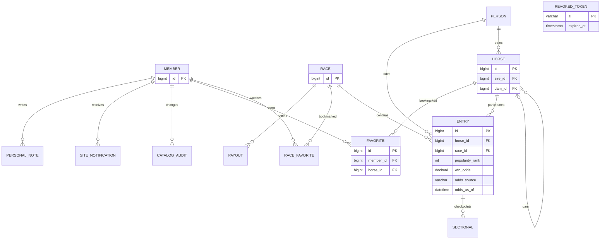

# 관계와 무결성

착순, 마번, 기수, 주파기록은 Horse가 아닌 Entry에 속합니다. (race_id, horse_id), (race_id, number), (member_id, horse_id), member.email에 UNIQUE를 둡니다. 말 부모는 nullable 자기 참조 FK이며 삭제는 RESTRICT입니다. 관리용 삭제 API는 제공하지 않습니다. 경주 개최일과 말 이름 인덱스, 전적 조회용 horse_id 인덱스를 둡니다. 부분 문자열 검색은 인덱스 전체 탐색 가능성이 있어 대규모 운영 전 검색 전략 재검토가 필요합니다.
Flyway가 스키마를 버전 관리하고 Hibernate는 validate로만 사용합니다. 샘플은 SQL migration으로 최초 1회 적재됩니다.

인기·단승 배당은 말 자체가 아닌 경주별 Entry의 스냅샷입니다. V4는 nullable 인기(양수), 단승 배수(DECIMAL(7,1), 1.0 이상), 출처, UTC 시각을 추가합니다. 네 값이 모두 있거나 모두 없는 상태만 허용하며 기존 데이터와 V1~V3는 변경하지 않습니다. 가상 배당은 현재 착순 및 ML 입력·출력에서 생성하지 않습니다.

V5의 `race_favorite`는 회원·경주 FK와 `(member_id,race_id)` UNIQUE를 가집니다. 관심 말은 기존 `favorite`를 유지하며 일정은 두 관심 목록에서 동적으로 조회·병합합니다. 성적은 완료 `entry`를 집계하고 별도 통계 테이블을 중복 저장하지 않습니다.

V6는 출마표 상세·경주/출전 상태·revision·관리자 권한과 sectional/payout/catalog_audit를 추가합니다. sectional은 `(entry_id,distance)`, payout은 `(race_id,market,combination)` UNIQUE입니다. V8은 환급 상태별 필수값의 NULL 제약을 보강합니다.

V7은 기수/조교사 person ID와 FK, 회원별 personal_note와 site_notification을 추가합니다. 메모는 말 또는 경주 하나를 대상으로 하고 회원/대상별 UNIQUE입니다. 알림은 회원/경주/개최일별 UNIQUE이며 취소·삭제 없이 읽음 상태를 관리합니다. 관리자 수정은 revision과 잠금을 사용하며 자료 변경과 감사 이력을 같은 transaction에 기록합니다.

## V9 한국마사회 자료 식별과 보존
- `horse.kra_id`: nullable 고유 문자열. `person`은 `(kind,kra_id)` 고유. `race.kra_id`는 경마장번호·경주일·경주번호를 결합한 고유 문자열입니다. 기존 로컬 ID와 합성 자료를 보존합니다.
- `entry.trainer_id/trainer_name`: 경주 당시 담당자. 기존 자료에서는 null이고 현재 말 담당자로 집계합니다.
- `sectional_marker(entry_id,marker)` PK: 코너 번호(1~4), 통과 순위, 누적 시간, 출처. `entry` FK이며 거리 좌표가 있는 `sectional`과 구분합니다.
- `kra_race_import.race_id` PK/FK: 원본 JSON, SHA-256 지문, 수집/반영 시각. 기존 경주의 변경 원본을 자동 덮어쓰지 않습니다.
- 인기 순위와 단승 배당은 각각 선택값입니다. 둘 중 하나가 있으면 출처와 시각이 필수입니다.

## V10 한국마사회 기준 자료(말·혈통·인물·예정 경주)
- `horse.birth_date`를 NULL 허용으로 바꿨습니다. 선대마정보 API는 조상의 이름만 제공하므로 생년월일을 지어내지 않습니다.
- `horse.source`(기본 `synthetic_fixture`, 기존 `kra_id` 보유 행은 `KRA_API214_1`), `name_en`, `origin`(산지), `breed`, `kra_rank`(등급), `owner_name`, `profile_json`(제공기관 집계 전적: 통산/최근 1년 출주·착순, 승률, 상금), `profile_as_of`.
- `horse.ancestor_key`: 이름만 제공된 조상의 고유 키(`KRA:` + 대문자 이름). `kra_id`와 동시에 가질 수 없고(`ck_horse_ancestor`), 같은 이름의 말을 나중에 번호로 받으면 그 행을 승격해 `kra_id`를 채우고 키를 비웁니다. 부모 연결은 기존 `sire_id`/`dam_id`를 그대로 사용하므로 3대 혈통 조회(`CatalogService.ancestors`)가 변경 없이 동작합니다.
- `person.debut_date`, `retired_date`, `affiliation`(소속조), `profile_json`, `profile_as_of`.
- `race.prize_json`: 경주계획표의 착순 상금·부담구분·조건. 예정 경주는 `status='SCHEDULED'`, `source='KRA_API72_2'`, `kra_id='경마장:날짜:경주번호'`로 저장되며 같은 키의 결과가 들어오면 같은 행을 OFFICIAL로 승격합니다(관심 경주 FK 유지).
- `kra_master_import(kind, subject)` 고유: HORSE/PEDIGREE/JOCKEY/TRAINER/PLAN별 원본 JSON·지문·수집 시각. 재실행 시 갱신(ON DUPLICATE KEY UPDATE).
