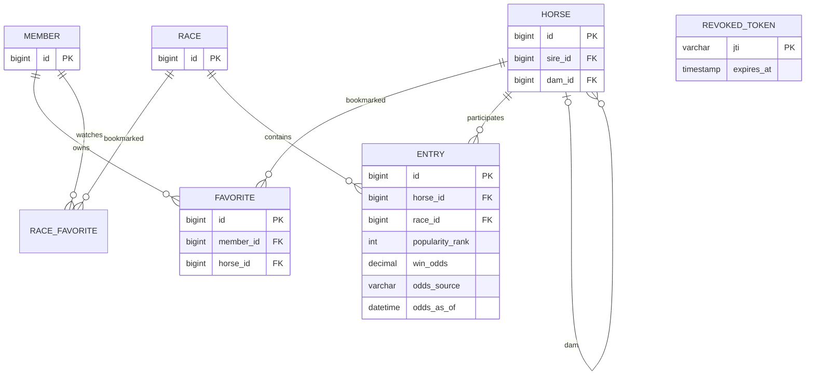

# 관계와 무결성

착순, 마번, 기수, 주파기록은 Horse가 아닌 Entry에 속합니다. (race_id, horse_id), (race_id, number), (member_id, horse_id), member.email에 UNIQUE를 둡니다. 말 부모는 nullable 자기 참조 FK이며 삭제는 RESTRICT입니다. 관리용 삭제 API는 제공하지 않습니다. 경주 개최일과 말 이름 인덱스, 전적 조회용 horse_id 인덱스를 둡니다. 부분 문자열 검색은 인덱스 전체 탐색 가능성이 있어 대규모 운영 전 검색 전략 재검토가 필요합니다.
Flyway가 스키마를 버전 관리하고 Hibernate는 validate로만 사용합니다. 샘플은 SQL migration으로 최초 1회 적재됩니다.

인기·단승 배당은 말 자체가 아닌 경주별 Entry의 스냅샷입니다. V4는 nullable 인기(양수), 단승 배수(DECIMAL(7,1), 1.0 이상), 출처, UTC 시각을 추가합니다. 네 값이 모두 있거나 모두 없는 상태만 허용하며 기존 데이터와 V1~V3는 변경하지 않습니다. 가상 배당은 현재 착순 및 ML 입력·출력에서 생성하지 않습니다.

V5의 `race_favorite`는 회원·경주 FK와 `(member_id,race_id)` UNIQUE를 가집니다. 관심 말은 기존 `favorite`를 유지하며 일정은 두 관심 목록에서 동적으로 조회·병합합니다. 성적은 완료 `entry`를 집계하고 별도 통계 테이블을 중복 저장하지 않습니다.
