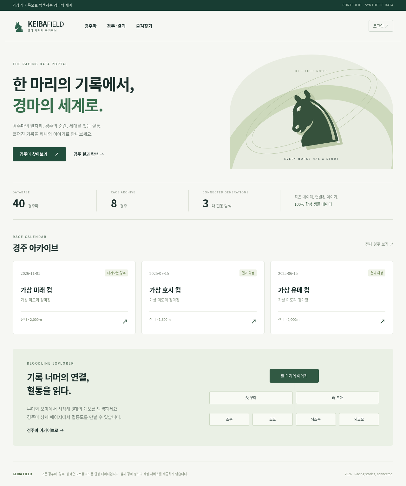

# KEIBA FIELD — 경마 데이터 포털

가상의 일본풍 경주마와 경주 기록을 탐색하는 풀스택 포트폴리오입니다. React 화면에서 Spring Boot REST API를 호출하여 **실제 MySQL**의 말·경주·전적·혈통·회원·즐겨찾기를 조회하고 변경합니다. 별도 FastAPI의 합성 데이터 실험 모델을 회원 전용 예측 기능으로 연결합니다.

실제 netkeiba 데이터/로고를 사용하지 않습니다. 모든 말 40두, 경주 8개, 출전 96건은 가상 데이터입니다. 출주마별 인기 순위·단승 배당은 가상 스냅샷으로 제공합니다. 실시간 배당 수집, 커뮤니티, 예측 정확도 보장은 범위에서 제외합니다.



## 기술
React 19 · Vite 7.3.7 · TypeScript · React Router / Java 21 · Spring Boot 3.5 · Security · JWT · BCrypt · JPA / MySQL 8.4 · Flyway / Python 3.12 · FastAPI · scikit-learn / Gradle 8.14.3 · Docker Compose · JUnit · Python unittest · Playwright.

## 실행
필수: Linux, Docker 엔진과 Compose v2, Python 3.12 및 venv, Node 22 이상. Java/Gradle은 공식 빌드 컨테이너로도 사용할 수 있습니다.

```bash
git clone https://github.com/hsubin756-pixel/horse_racing_portal.git
cd horse_racing_portal
./scripts/up.sh
```

이미 체크아웃한 클라우드 환경에서는 `/workspace/horse_racing_portal`로 이동한 뒤 `./scripts/up.sh`를 실행합니다. 이 스크립트는 기존 `.env`를 보존하며, 없으면 개발용 비밀값을 무작위로 생성합니다. `.env`는 0600 권한이고 Git에서 제외됩니다. 이미지 빌드, MySQL/Flyway 샘플 적재, 서비스 시작 및 실제 API 준비 확인까지 실행합니다. 처음 빌드는 의존성 다운로드가 필요합니다. scripts/build.sh가 백엔드 JUnit/ML 테스트와 프론트 빌드를 실행한 뒤 Docker runtime 이미지를 조립합니다.

웹 포트 5173, API 8080, ML 8000, DB 3306은 모두 호스트 loopback에만 바인딩됩니다. 이 클라우드 온보딩 UI에서는 로컬 웹 미리보기를 제공하지 않습니다. 브라우저 접근이 가능한 별도 개발 머신에서는 5173 포트로 접속하세요. 신규 회원은 회원가입 화면에서 직접 생성합니다. 기본 관리자/고정 비밀번호 계정은 없습니다.

```bash
docker compose ps
docker compose logs --tail=80 backend
docker compose stop           # 데이터 볼륨 보존
docker compose up -d          # 이미 빌드된 서비스 재시작
python3 scripts/wait-ready.py # MySQL 기반 조회·API·ML·웹 프록시 확인
```

`docker compose down -v`는 DB 데이터를 삭제하므로 사용하지 마세요. 환경의 live 프로세스는 스냅샷에 보존된다고 가정하지 않습니다. 새 task에서는 기존 체크아웃을 사용하고 `docker compose up -d` 후 준비 확인을 실행하세요. 별도 Git worktree는 필요하지 않습니다.

## 개발
```bash
python3 scripts/init-env.py
python3 scripts/prepare-build.py
mkdir -p .runtime/docker
./scripts/build.sh
DOCKER_CONFIG="$PWD/.runtime/docker" docker compose up -d db ml
./scripts/gradle.sh build
python3 scripts/backend-local.py
cd frontend
npm ci --cache ../.runtime/npm
npm run dev
```
이미 전체 Compose가 실행 중이면 backend/frontend 컨테이너를 먼저 중지해 포트 충돌을 해소하세요. 로컬 백엔드는 `python3 scripts/backend-local.py stop`으로 종료합니다. Vite 프록시가 8080 API를 전달합니다. ML 모델은 컨테이너에서 학습되므로 호스트 Python 학습은 필수가 아닙니다.

```bash
# 별도로 호스트에서 ML 개발/테스트
python3 -m venv .runtime/ml-venv
.runtime/ml-venv/bin/pip install --cache-dir .runtime/pip -r ml/requirements.lock
.runtime/ml-venv/bin/python ml/train.py
.runtime/ml-venv/bin/python -m unittest discover -s ml -p 'test_*.py' -v
```

## 검증
```bash
./scripts/gradle.sh build
python3 -m unittest discover -s tests -v
python3 tests/scale.py # 별도 DB에서 10,040두/50명/30초 부하
python3 scripts/backup.py # 원본을 유지하며 별도 스키마 복원 확인
cd frontend
npm run build
PLAYWRIGHT_CHROMIUM_EXECUTABLE=/usr/bin/chromium npm run test:e2e
```
API 테스트는 실행 중인 Spring/MySQL/FastAPI를 사용하며 테스트 회원을 생성합니다. 테스트 전용/개발 DB에서 실행하세요. Playwright는 시스템 Chromium을 사용하거나 `npx playwright install chromium` 후 실행할 수 있습니다. 전자는 클라우드 다운로드 정책 변경 없이 사용할 수 있습니다. ML 장애 검증은 `docker compose stop ml`, `python3 tests/check_outage.py`, `docker compose start ml`, 준비 확인 순서입니다.

## 한국마사회 API 개발계정 승인 후

[인증키 설정·연결 확인 안내](docs/KRA_API.md)를 참고하세요. WSL에서 아래 명령을 실행하면 키를 숨김 입력으로 저장하고 문서 예제 경주의 원본 응답을 내려받습니다. Docker 재빌드와 추가 Python 패키지는 필요하지 않습니다.

```bash
python3 scripts/kra.py configure
python3 scripts/kra.py check --meet 1 --date 20220220 --race 1
```

키와 다운로드 자료는 Git에서 제외된 `.runtime/kra/`에만 저장합니다. 실제 API 연결은 사용자 PC의 키와 네트워크로 확인해야 합니다. 현재는 원본 수집 단계이며 사이트 DB 반영은 포함하지 않습니다. 사이트에는 기존 합성 자료가 표시됩니다.

## 화면 및 도메인
- 부분 이름 검색, 20건 페이지, 성별/생년 정렬 → 상세 → 최신 완료 전적 → 경주 결과로 이동.
- 경주명/개최일 AND 검색 → 마번·기수·인기·단승 배당·기록·착순, 말 상세로 이동. 인기순/배당순 정렬과 자료 기준 시각을 제공하며 미제공 값은 구분합니다.
- 회원가입/로그인 → 본인 즐겨찾기 추가·목록·삭제, 중복 거부.
- JWT는 메모리에 보관하고 30분에 만료합니다. 새로고침 시 다시 로그인합니다. 서버 DB에서 로그아웃 토큰을 철회합니다.
- 양쪽 부모의 3대 혈통 트리, 누락 표시 및 제한된 재귀.
- 최대 4두 비교와 말·기수 조건별 성적: 거리/주로/기간 필터, 최근 5경주, 승률·3위 이내 비율.
- 회원별 관심 경주 저장·삭제, 관심 말 출전을 합친 90일 일정과 사이트 내 안내.
- 회원만 Spring을 통해 FastAPI 예측 요청. 합성 실험·면책 표시와 서비스 장애 안내.

## 문서
[설계](ARCHITECTURE.md) · [ERD](ERD.md) · [API](API.md) · [요구사항 추적](REQUIREMENTS_TRACEABILITY.md) · [결정](DECISIONS.md) · [검증 결과](TEST_REPORT.md) · [진행](PROGRESS.md) · [학습용 호출 흐름](docs/LEARNING.md) · [디렉터리](docs/STRUCTURE.md) · [운영 준비](docs/DEPLOYMENT.md) · [실제 데이터 평가](docs/ML_DATA.md) · [확장 기능·관리자 사용법](docs/RACE_FEATURES.md) · [넷케이바 기능 비교와 확인 제한](docs/NETKEIBA_COMPARISON.md) · [원본 SRS](docs/SRS.docx).

OpenAPI는 실행 서버의 `/v3/api-docs`, Swagger UI는 `/swagger-ui/index.html`입니다. 프론트 프록시는 `/api`만 전달하므로 문서는 API 포트에서 확인합니다.

예측 모델의 실제 경마 성능은 검증되지 않았습니다. [모델 보고서](ml/model-report.json)의 합성 실험 수치를 실제 정확도로 인용하지 마세요. 현재 검증 범위와 제한은 TEST_REPORT.md에 기록합니다.

GitHub `main`에 소스가 게시되어 있습니다. [Actions 실행 목록](https://github.com/hsubin756-pixel/horse_racing_portal/actions)에서 원격 CI 결과를 확인할 수 있습니다. 이 환경에서는 GitHub API 접근 제한으로 원격 CI 성공 여부를 확인하지 못했습니다.

2026-10-22 개선: JWT 필수 claims 검사, ML 응답/시간초과 처리, 검색 wildcard 문자 처리, DB 연결 사용 개선, 네트워크 오류 한국어 안내, 프록시 로그인 요청 제한을 추가했습니다. 확장 합성 DB의 동시 50명·30초 조회 시험은 14,017요청, 오류 0건, p95 246ms였습니다. 이는 장기 운영 성능 보장이 아닙니다. 백업의 별도 스키마 복원과 HTTPS 배포 구성을 준비했으며, 공개 배포에는 서버·도메인이 필요합니다.

경주 상세와 말의 과거 전적에 표시하는 단승 배당은 원금을 포함한 배수(예: 2.4배)입니다. 현재 모든 값은 가상 샘플로 실제 배당·확정 환급금이 아닙니다. 인기 순위는 착순 또는 ML 예측 순위와 별도입니다. 예정 경주에는 미제공 상태 예시가 1건 있습니다. 기존 설치는 최신 소스를 받은 뒤 `./scripts/up.sh`로 재빌드하면 Flyway V4가 기존 DB를 확장하며 회원·즐겨찾기를 보존합니다.

추가 화면은 `/compare`(경주마 비교), `/statistics`(말·기수 조건별 성적), `/watchlist`(회원 관심 일정)입니다. 말 상세의 비교/성적 링크와 경주 출주표의 기수 링크에서도 이동합니다. `git pull --ff-only` 후 기존 Python 3.12 환경에서 `./scripts/up.sh`를 실행하면 V5가 관심 경주 테이블을 추가합니다. 기존 데이터 볼륨을 삭제하지 않습니다. 일정은 사이트를 조회할 때 보여주며 이메일·푸시 발송은 포함하지 않습니다.


## 출마표·구간 기록과 추가 기능
경주 상세에 발주 시각·등급·날씨/주로·중량·취소 상태, 개별 말의 거리별 통과 순위와 누적/구간 시간, 조합별 예상 배당·확정 환급표를 표시합니다. 말 상세에서는 최근 10경주의 주행 스타일 분포·마지막 600m·착순 추이와 선택한 경주의 순위 흐름을 확인합니다. 스타일은 초반 위치 기반 규칙이며 실제 능력 예측이 아닙니다.

상단 보조 메뉴에 개최 캘린더(`/calendar`), 기수·조교사(`/people`), 개인 메모(`/notes`), 알림함(`/notifications`), 자료 관리(`/admin`)를 추가했습니다. 관리자 입력/CSV 미리보기·저장·정정·변경 이력은 [사용 안내](docs/RACE_FEATURES.md)를 참고하세요.

관리자는 기본으로 생성하지 않습니다. 먼저 가입한 뒤 저장소의 WSL 터미널에서 `python3 scripts/admin.py 실제가입이메일`로 지정하고 해당 계정으로 로그인합니다. 권한 회수는 같은 명령에 `--revoke`를 붙입니다. 이메일/비밀번호를 코드에 저장하지 않습니다.

기존 설치는 `git pull --ff-only` → `source .runtime/build-python/bin/activate` → `./scripts/up.sh` 순으로 업데이트합니다. Flyway V6~V8이 기존 DB를 확장하며 데이터 볼륨을 삭제할 필요가 없습니다. 기본 구간 기록·배당은 가상 샘플이고 실제 데이터 자동 수집은 없습니다. 알림은 알림함 조회/갱신 시 사이트 안에 생성하며 이메일·푸시 발송은 하지 않습니다.
