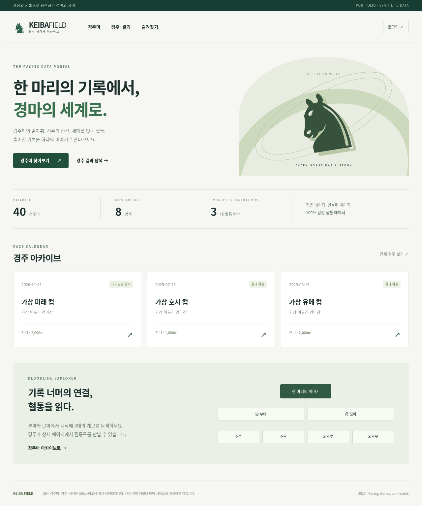
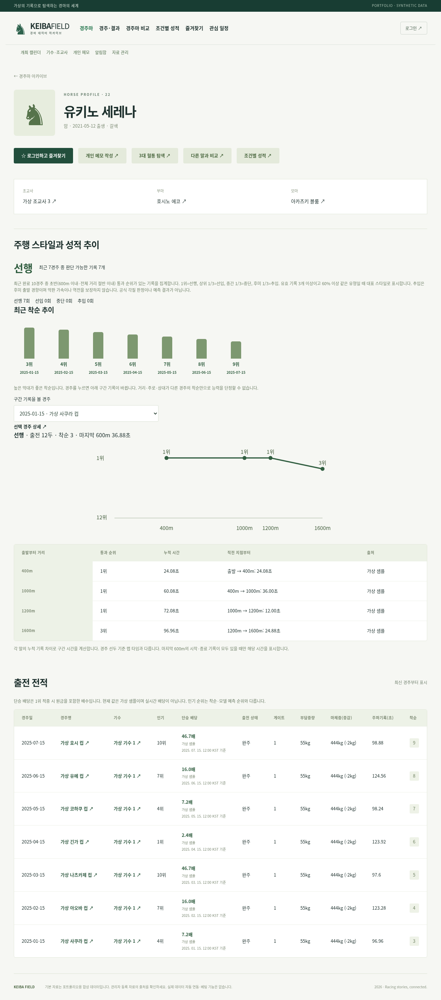
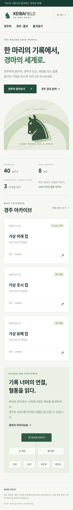
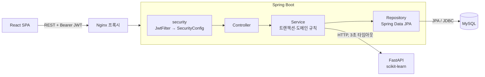

# KEIBA FIELD — 경마 데이터 포털

netkeiba.com의 정보 구조를 참고해 만든 **풀스택 경마 정보 서비스**입니다. React 화면이 Spring Boot REST API를 호출하고, API가 MySQL에서 경주마·경주·전적·혈통·회원 데이터를 읽고 씁니다. 로그인한 회원은 별도의 FastAPI 서비스에서 경주 예측 점수를 받을 수 있습니다.

기본으로 설치되는 데이터는 **가상 샘플**(말 40두·경주 8개·출전 96건)입니다. 한국마사회 공공데이터 API로 받은 **실제 경주 결과**는 사용자 PC에서 따로 수집해 반영하며, 화면과 DB에서 출처로 구분합니다. netkeiba의 데이터·로고·디자인 자산은 사용하지 않습니다.



| 경주마 주행 스타일 | 모바일 |
|---|---|
|  |  |

## 주요 기능

| 영역 | 내용 |
|---|---|
| 경주마 | 부분 이름 검색, 20건 페이지, 정렬 → 상세(기본 정보·최신순 전적·주행 스타일) |
| 경주 | 경주명·개최일 검색 → 출마표·착순·기록·인기·단승 배당, 구간 통과 순위 비교 |
| 혈통 | 부마·모마 자기 참조 관계로 3대 혈통 트리, 누락 조상 표시 |
| 회원 | 회원가입·로그인(JWT)·로그아웃(토큰 철회), BCrypt 해시 저장 |
| 즐겨찾기 | 경주마·경주 관심 등록, 관심 말 출전 예정을 합친 90일 일정 |
| 분석 | 최대 4두 비교, 말·기수의 거리·주로·기간별 성적 |
| 예측 (회원 전용) | Spring → FastAPI 호출, 출주마별 점수와 면책 문구, ML 장애 시 503 안내 |
| 운영 | 관리자 자료 편집·CSV 미리보기·변경 이력, 한국마사회 수집 상태 화면 |

## 기술 스택

- **Backend**: Java 21, Spring Boot 3.5, Spring Security, JWT(jjwt), Spring Data JPA, Bean Validation, springdoc-openapi
- **Database**: MySQL 8.4, Flyway(V1~V12 마이그레이션, Hibernate는 `validate`만)
- **Frontend**: React 19, TypeScript, Vite, React Router
- **ML**: Python 3.12, FastAPI, scikit-learn
- **Infra / Test**: Docker Compose, Gradle, JUnit 5 + Mockito + MockMvc, Python unittest, Playwright, GitHub Actions

## 아키텍처



백엔드는 기능별 패키지로 나눴습니다. 패키지 사이에는 public으로 공개한 서비스·DTO만 오가고, 엔티티 필드는 패키지 안에서만 다룹니다.

```text
dev.keiba
├── common      예외 → HTTP 응답 변환, 헬스 체크, 시계(Clock) 설정
├── security    SecurityConfig, JwtFilter, JwtService
├── member      회원가입·로그인·로그아웃, 철회 토큰
├── catalog     Horse·Race·Entry 엔티티, 검색·상세·전적·혈통, 구간 기록, 기수·조교사
├── analytics   조건별 성적 비교
├── favorite    경주마 즐겨찾기, 관심 경주·일정
├── note        개인 메모, 사이트 알림
├── prediction  예측 입력 수집(트랜잭션 안) → FastAPI 호출(트랜잭션 밖)
└── admin       관리자 자료 편집·감사 기록, 수집 상태
```

자세한 호출 흐름은 [ARCHITECTURE.md](ARCHITECTURE.md), [docs/STRUCTURE.md](docs/STRUCTURE.md), [docs/LEARNING.md](docs/LEARNING.md)에 있습니다.

## 설계하면서 고민한 점

**1. 경주마와 경주의 다대다 관계를 `Entry`로 표현**
한 말은 여러 경주에 나가고 한 경주에는 여러 말이 나갑니다. 착순·마번·기수·기록은 말이나 경주가 아니라 "이 경주에 나간 이 말"에 속하는 값이라서, `@ManyToMany` 대신 `Entry` 엔티티를 두고 `(race_id, horse_id)`, `(race_id, number)`에 UNIQUE 제약을 걸었습니다. → [ERD.md](ERD.md)

**2. 인증은 화면이 아니라 서버가 강제**
`JwtFilter`가 서명·만료·필수 claim, 로그아웃된 토큰(jti), 회원 존재 여부를 확인한 뒤 회원 ID만 `SecurityContext`에 넣습니다. 즐겨찾기 API는 요청 값이 아니라 토큰의 회원 ID로만 조회·삭제하므로 다른 회원의 데이터를 지정할 방법이 없습니다. 허용 목록에 없는 경로는 `denyAll`로 막았습니다. 이 규칙은 `FavoriteSecurityTest`(MockMvc)로 검증합니다.

**3. 외부 ML 호출 동안 DB 연결을 붙잡지 않기**
`PredictionFeatures`가 읽기 전용 트랜잭션 안에서 출주마와 과거 전적을 한 번에 모아 불변 입력으로 돌려주고, `PredictService`는 트랜잭션 밖에서 FastAPI를 호출합니다. 연결 2초·응답 3초 타임아웃, 응답 형식 검증, 장애 시 503 안내를 둡니다.

**4. 혈통은 자기 참조 관계 + 방어적 재귀**
`horse.sire_id`, `horse.dam_id`가 같은 테이블을 가리킵니다. 3대까지만 펼치고, 데이터가 잘못돼 순환이 생겨도 같은 말을 다시 펼치지 않으며, 조상이 없으면 `null`로 표시해 화면이 깨지지 않게 했습니다.

**5. 예측 모델은 성능을 과장하지 않기**
한국마사회 공개 자료로 학습한 실험 모델을 **배당(시장) 기준선과 같은 경주에서 비교**했습니다. 2025년 서울 세 검증 구간 ROC-AUC는 모델 0.714 / 0.742 / 0.736, 배당 기준선 0.791 / 0.822 / 0.767로 **모든 구간에서 시장보다 낮았습니다.** 그래서 화면에는 "실험 모델"과 면책 문구를 표시하고, 후보 모델은 학습 마감일과 미래 검증 기간을 미리 고정한 뒤에만 평가하도록 했습니다. → [docs/ML_DATA.md](docs/ML_DATA.md), [docs/ML_VALIDATION_PLAN.md](docs/ML_VALIDATION_PLAN.md)

**6. 공공데이터 수집은 다시 시작할 수 있게**
날짜×경마장 단위로 진행 상태를 저장해 중단 후 이어서 받고, 하루 호출 한도를 지키며, 형식이 맞지 않는 경주는 추정하지 않고 원본과 사유를 보존해 보류합니다. 사용자 PC 기준 최근 3개월 276개 작업 중 270개를 반영했고, 남은 6개는 제공기관 원본에 착순·거리가 비어 있는 경우입니다. → [docs/KRA_SYNC.md](docs/KRA_SYNC.md)

## 테스트와 검증

| 종류 | 위치 | 내용 |
|---|---|---|
| 백엔드 단위·슬라이스 | `backend/src/test` | 서비스 규칙(Mockito), JWT, `@WebMvcTest`로 인증·입력 검증·예외 응답 |
| API 통합 | `tests/` | 실행 중인 Spring·MySQL·FastAPI에 실제 HTTP 요청 |
| 부하 | `tests/scale.py` | 별도 DB(10,040두·1,008경주)에서 50명 30초: 14,017요청, 오류 0, p95 246ms |
| ML | `ml/test_*.py` | 학습·평가·응답 계약, 검증 묶음 무결성 |
| E2E | `frontend/e2e` | Chromium으로 검색·로그인·즐겨찾기·예측 흐름 |

부하 수치는 로컬 1회 측정이며 운영 성능을 보장하지 않습니다. 실행 결과와 아직 확인하지 못한 항목은 [TEST_REPORT.md](TEST_REPORT.md)에 구분해 기록합니다.

## 실행

필요: Linux 또는 WSL2, Docker 엔진 + Compose v2, Python 3.12(또는 3.13), Node 22 이상.

```bash
git clone https://github.com/hsubin756-pixel/horse_racing_portal.git
cd horse_racing_portal
./scripts/up.sh          # .env 생성 → 빌드·테스트 → Compose 기동 → 준비 확인
```

- 웹 `http://localhost:5173`, API `8080`, Swagger UI `http://localhost:8080/swagger-ui/index.html`
- 포트는 모두 호스트 loopback에만 열립니다. 기본 관리자 계정은 없으며 회원가입 후 `python3 scripts/admin.py 이메일`로 지정합니다.
- 기본 python3가 3.14 이상이면 `ML_PYTHON=$(~/.local/bin/uv python find 3.12) ./scripts/up.sh`처럼 지정합니다.

```bash
docker compose ps
docker compose stop            # 데이터 보존
docker compose up -d           # 재시작
python3 scripts/wait-ready.py  # DB·API·ML·웹 준비 확인
```

`docker compose down -v`는 DB 볼륨을 지우므로 사용하지 마세요.

### 개발·검증 명령

```bash
./scripts/gradle.sh build                     # 백엔드 컴파일 + JUnit
python3 tests/run_isolated.py                # API 통합 테스트: 임시 스키마·임시 백엔드에서 실행 후 삭제
cd frontend && npm run build && npm run test:e2e
```

로컬 개발 서버, ML 단독 개발, 장애 시험 절차는 [docs/DEVELOPMENT.md](docs/DEVELOPMENT.md)를 참고하세요.

### 한국마사회 실제 데이터

공공데이터포털 인증키를 받은 뒤 사용자 PC에서 실행합니다. 키와 원본은 Git에서 제외된 `.runtime/kra/`에만 저장합니다.

```bash
python3 scripts/kra.py configure                              # 키 숨김 입력
python3 scripts/kra.py check --meet 1 --date 20220220 --race 1
```

수집·반영·백업·예약 갱신: [KRA_API](docs/KRA_API.md) · [KRA_SYNC](docs/KRA_SYNC.md) · [KRA_OPERATIONS](docs/KRA_OPERATIONS.md) · [KRA_BACKUP](docs/KRA_BACKUP.md)

## 범위 밖

실시간 배당 수집, 베팅, 예측 정확도·수익 보장, 공개 서버 배포(서버·도메인 미확보 — 배포 구성은 [docs/DEPLOYMENT.md](docs/DEPLOYMENT.md)에 준비).

## 문서

[현재 현황](docs/CURRENT_STATUS.md) · [아키텍처](ARCHITECTURE.md) · [ERD](ERD.md) · [API](API.md) · [요구사항 추적](REQUIREMENTS_TRACEABILITY.md) · [설계 결정](DECISIONS.md) · [테스트 결과](TEST_REPORT.md) · [진행 기록](PROGRESS.md) · [학습용 호출 흐름](docs/LEARNING.md) · [디렉터리](docs/STRUCTURE.md) · [추가 기능 사용법](docs/RACE_FEATURES.md) · [netkeiba 기능 비교](docs/NETKEIBA_COMPARISON.md) · [README 이전 기록](docs/HISTORY.md) · [원본 SRS](docs/SRS.docx)
