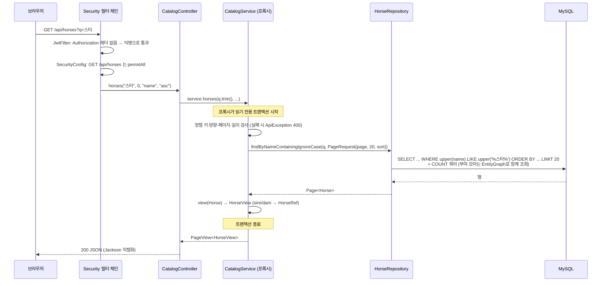
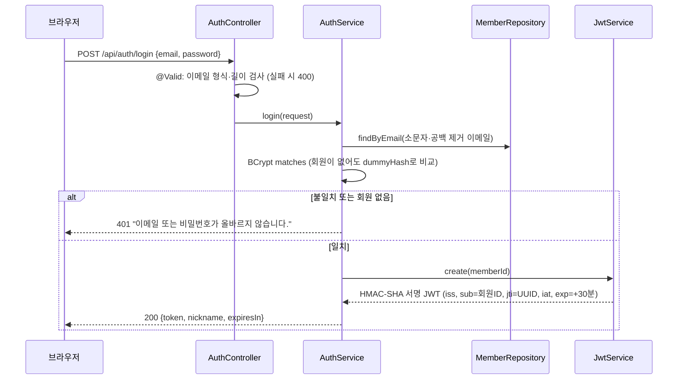
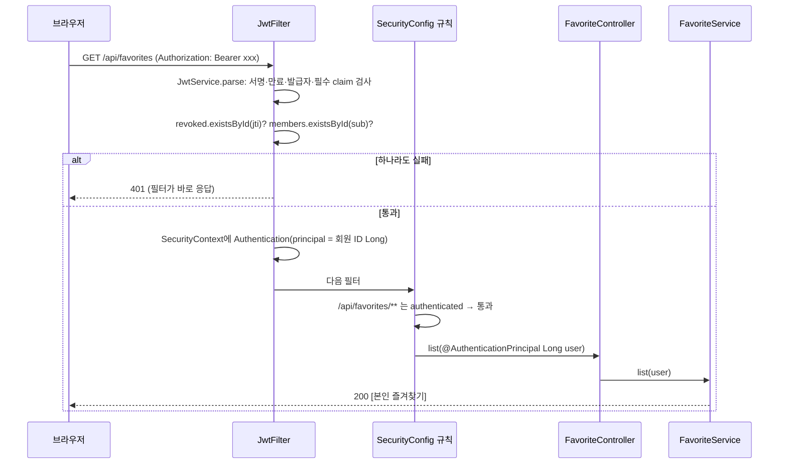

# 코드 읽기·재구현·면접 대비 가이드

이 문서는 코드를 직접 다시 구현하거나 면접에서 설명할 때 쓰는 안내서입니다. 모든 설명은 `backend/src/main/java/dev/keiba` 아래의 실제 코드를 기준으로 하며, 클래스·메서드 이름을 그대로 적었습니다. 패키지 구조는 [STRUCTURE.md](STRUCTURE.md), 테이블 관계는 [ERD.md](../ERD.md)를 함께 보세요.

## 1. 읽는 순서

1. `resources/db/migration/V1__schema.sql`, `V3__members.sql` — 테이블·FK·UNIQUE를 먼저 봅니다. 엔티티는 이 스키마에 맞춰 만든 것입니다(`ddl-auto: validate`).
2. `catalog/Horse`, `Race`, `Entry` — 엔티티와 관계.
3. `catalog/CatalogController → CatalogService → HorseRepository` — 가장 단순한 조회 흐름.
4. `security/SecurityConfig`, `JwtFilter`, `JwtService` → `member/AuthService` — 인증.
5. `favorite/FavoriteService` — 인증된 회원 ID로 데이터를 다루는 방법.
6. `prediction/PredictionFeatures → PredictService` — 트랜잭션과 외부 호출 분리.
7. `common/ApiExceptionHandler` — 예외가 HTTP 응답이 되는 지점.

## 2. 계층별 역할

| 계층 | 하는 일 | 하지 않는 일 | 예 |
|---|---|---|---|
| Controller | URL·HTTP 메서드 매핑, 요청 값 바인딩·형식 검증(`@Valid`), 인증 회원 ID 받기(`@AuthenticationPrincipal`) | 비즈니스 규칙, DB 접근 | `CatalogController.horses()` |
| Service | 도메인 규칙, 트랜잭션 경계(`@Transactional`), 엔티티 → 응답 DTO 변환 | HTTP 세부 사항 | `CatalogService.horses()` |
| Repository | SQL 생성·실행(Spring Data JPA) | 규칙 판단 | `HorseRepository.findByNameContainingIgnoreCase()` |
| Entity | 테이블 한 행과 관계 매핑 | 응답으로 직접 직렬화 | `Horse`, `Entry` |
| DTO(record) | 응답 모양 고정 | 지연 로딩 | `CatalogService.HorseView` |

응답에는 항상 record DTO만 내보냅니다. 엔티티를 그대로 JSON으로 만들면 `Horse.sire → Horse.sire …` 같은 순환 참조, 지연 로딩 예외, `Member.passwordHash` 노출이 생길 수 있기 때문입니다.

## 3. 요청 하나가 응답이 되기까지: 경주마 검색

`GET /api/horses?q=스타&page=0`



포인트:

- **메서드 이름이 곧 쿼리**: `findByNameContainingIgnoreCase(String, Pageable)`에서 Spring Data가 대소문자를 무시하는 `LIKE '%검색어%'` 조건을 만들고, `Pageable`로 `LIMIT/OFFSET`과 전체 개수 `COUNT` 쿼리를 추가합니다.
- **정렬 키 화이트리스트**: `sort`를 그대로 넘기면 클라이언트가 임의의 필드로 정렬을 요청할 수 있으므로 `name·sex·birthDate`만 허용합니다. 같은 값일 때 순서가 흔들리지 않도록 `id`를 두 번째 정렬 기준으로 붙입니다.
- **한계**: 앞뒤 `%` LIKE는 `ix_horse_name` 인덱스를 타지 못해 전체 탐색이 될 수 있습니다. 10,040두 부하 시험에서는 p95 246ms였지만, 데이터가 커지면 전문 검색(FULLTEXT·n-gram) 검토가 필요합니다.

## 4. JPA가 DB와 만나는 지점

### 4.1 다대다를 `Entry`로 푼 이유

```text
Horse 1 ─── N Entry N ─── 1 Race
```

`@ManyToMany`는 중간 테이블에 두 FK만 둘 수 있습니다. 하지만 착순·마번·기수·기록·배당은 "이 경주에 나간 이 말"의 속성이라 중간 테이블에 있어야 합니다. 그래서 `Entry`를 독립 엔티티로 만들고 `@ManyToOne(fetch = LAZY)` 두 개로 연결했습니다. DB에는 `UNIQUE(race_id, horse_id)`(같은 말 중복 출전 방지)와 `UNIQUE(race_id, number)`(마번 중복 방지)를 둡니다.

### 4.2 지연 로딩과 N+1

- 모든 연관은 `FetchType.LAZY`입니다. `entry.horse`는 처음에 프록시이고, 실제로 필드를 읽을 때 SELECT가 나갑니다.
- 전적 20건을 읽고 각 건의 말·경주를 따로 가져오면 1 + 20 + 20번 쿼리가 나갑니다(N+1). 그래서 필요한 곳에서 한 번에 가져옵니다.
  - `EntryRepository.findByHorseIdOrderByRaceRaceDateDesc` — `@EntityGraph(attributePaths = {"horse", "race"})`
  - `EntryRepository.pastForHorses` — JPQL `join fetch e.horse`
  - `HorseRepository.findByNameContainingIgnoreCase` — `@EntityGraph({"sire", "dam"})`
- `Hibernate.unproxy(entry.horse, Horse.class)`는 프록시를 실제 엔티티로 바꿉니다. 프록시 클래스는 `Horse`의 하위 클래스라 필드를 직접 읽으면 초기화되지 않은 값이 보일 수 있으므로, 서비스에서 필드를 읽기 전에 사용합니다.

### 4.3 `open-in-view: false`와 DTO 변환 위치

`application.yml`에서 OSIV를 껐습니다. 그래서 트랜잭션이 끝난 뒤(컨트롤러·JSON 직렬화 단계)에는 지연 로딩이 불가능합니다. 이 때문에 **서비스의 `@Transactional(readOnly = true)` 안에서 DTO로 다 바꿔서** 반환합니다. DB 연결을 요청 전체가 아니라 서비스 메서드 동안만 쓰게 되는 장점도 있습니다.

### 4.4 스키마는 Flyway가, Hibernate는 검사만

- `db/migration/V1~V12`가 테이블 생성·변경 이력입니다. 실행 시 Flyway가 아직 적용하지 않은 버전만 순서대로 실행하고 `flyway_schema_history`에 기록합니다.
- `ddl-auto: validate`라서 Hibernate는 엔티티와 테이블이 맞는지 검사만 하고 스키마를 바꾸지 않습니다. 운영 DB를 코드가 몰래 바꾸는 일을 막습니다.

### 4.5 중복 등록: 애플리케이션 검사 + DB 제약

`FavoriteService.add()`는 `existsByMemberIdAndHorseId`로 먼저 확인하고 409를 던집니다. 그래도 두 요청이 동시에 들어오면 둘 다 검사를 통과할 수 있습니다. 이때는 `UNIQUE(member_id, horse_id)`가 두 번째 INSERT를 막고, 발생한 `DataIntegrityViolationException`을 `ApiExceptionHandler.duplicate()`가 409로 바꿉니다. 회원가입 이메일도 같은 구조입니다(`uq_email`).

## 5. 인증 흐름 (Spring Security + JWT)

### 5.1 로그인



- 비밀번호는 `BCryptPasswordEncoder(12)` 해시만 저장합니다. BCrypt는 72바이트 이후를 무시하므로, 그보다 긴 비밀번호는 가입 단계에서 거부합니다.
- 없는 이메일과 틀린 비밀번호에 **같은 메시지와 비슷한 처리 시간**을 줍니다(`dummyHash`). 가입 여부를 알아내는 것을 어렵게 하기 위해서입니다.

### 5.2 인증이 필요한 요청



- `SecurityConfig.chain()`의 규칙 순서: 로그인·가입 POST 허용 → 공개 GET 허용 → 회원 전용 경로 `authenticated()` → 나머지 `denyAll()`. 새 API를 추가하고 규칙을 빠뜨리면 기본적으로 막힙니다.
- 헤더가 없는 요청은 `JwtFilter`가 그냥 통과시키고, 회원 전용 경로라면 `authenticationEntryPoint`가 401을 보냅니다. 로그인했지만 허용 목록에 없는 경로는 `accessDeniedHandler`가 403을 보냅니다.
- **회원 ID는 토큰에서만 나옵니다.** 즐겨찾기 API는 URL이나 본문으로 회원 ID를 받지 않으므로, A 회원이 B 회원의 즐겨찾기를 지정할 방법 자체가 없습니다. 삭제도 `deleteByMemberIdAndHorseId(user, horse)`라서 다른 회원 행은 조건에 걸리지 않습니다.
- 세션을 쓰지 않으므로(`STATELESS`) CSRF 보호를 껐습니다. 토큰은 쿠키가 아니라 브라우저 메모리에 두고 `Authorization` 헤더로 보냅니다.
- `SecurityConfig.jwtRegistration()`은 `JwtFilter`가 서블릿 필터로 한 번 더 자동 등록되는 것을 막습니다. Security 체인 안에서만 실행되게 하기 위해서입니다.

### 5.3 로그아웃

JWT는 서버에 상태가 없어서 원래는 만료 전까지 취소할 수 없습니다. 그래서 `AuthService.logout()`이 토큰의 `jti`와 만료 시각을 `revoked_token` 테이블에 저장하고, `JwtFilter`가 매 요청마다 이 테이블을 확인합니다. 만료가 지난 행은 지워도 되므로 정기 청소를 권장합니다([DECISIONS.md](../DECISIONS.md)).

## 6. 트랜잭션과 외부 호출: 예측

`POST /api/races/{id}/prediction`

```text
PredictController.predict(id)
 └─ PredictService.predict(id)              ← 트랜잭션 없음
     ├─ PredictionFeatures.forRace(id)      ← @Transactional(readOnly = true)
     │    출주마·과거 전적을 한 번에 조회해 불변 Input 생성 → 트랜잭션 종료, DB 연결 반환
     └─ RestClient POST http://ml:8000/predict(/real)   (연결 2초, 응답 3초 타임아웃)
          응답 검증(모델 종류·말 ID 일치·점수 0~1) → 점수순 정렬 → 면책 문구와 함께 반환
          실패·시간 초과·형식 오류 → ApiException 503
```

- **왜 클래스를 둘로 나눴나**: ML 서버가 3초 동안 응답하지 않을 때 그 시간 내내 DB 연결을 붙잡고 있으면, 요청이 몰리면 커넥션 풀이 고갈됩니다. 그래서 DB 작업만 트랜잭션 안에서 끝냅니다.
- **왜 같은 클래스의 메서드가 아니라 별도 빈인가**: `@Transactional`은 스프링 프록시가 처리합니다. 같은 클래스 안에서 `this.forRace()`로 부르면 프록시를 거치지 않아 트랜잭션이 적용되지 않습니다(self-invocation). 별도 빈 `PredictionFeatures`로 분리하면 호출이 프록시를 지나갑니다.
- **미래 정보 누출 방지**: 가상 경주의 입력은 `EntryRepository.pastForHorses(ids, race.raceDate)`로 **경주일보다 이전**의 완료 기록만 사용합니다.

## 7. 예외 처리

| 발생 | 처리 | 응답 |
|---|---|---|
| 서비스의 `throw new ApiException(404, "...")` | `ApiExceptionHandler.domain()` | 지정 상태 + `{"message"}` |
| `@Valid` 실패, JSON 형식 오류, 타입 변환 실패 | `ApiExceptionHandler.invalid()` | 400 |
| UNIQUE 위반(`DataIntegrityViolationException`) | `ApiExceptionHandler.duplicate()` | 409 |
| 인증 실패 | `JwtFilter`, `authenticationEntryPoint` | 401 |
| 권한 없음 | `accessDeniedHandler` | 403 |

`server.error.include-message: never`로 예상하지 못한 예외의 내부 메시지는 응답에 넣지 않습니다.

## 8. 테스트 구성

| 테스트 | 무엇을 | 어떻게 |
|---|---|---|
| `AuthServiceTest`, `FavoriteServiceTest`, `CatalogServiceTest` | 서비스 규칙 | 리포지토리를 Mockito `mock()`으로 대신하고 스프링 없이 `new`로 생성 |
| `FavoriteSecurityTest`, `AuthControllerTest` | 인증·입력 검증·예외 응답 | `@WebMvcTest`로 웹 계층만 띄우고 실제 `SecurityConfig`·`JwtFilter`·`JwtService` 사용, 나머지는 `@MockitoBean` |
| `tests/*.py` | 실제 API | 실행 중인 Spring·MySQL·FastAPI에 HTTP 요청 |
| `frontend/e2e` | 사용자 흐름 | Playwright + Chromium |

`catalog/CatalogFixtures`(테스트 소스)는 엔티티 필드를 같은 패키지에서 채워 주는 생성기입니다. 다른 패키지의 테스트가 DB 없이 `Horse`·`Race`·`Entry`를 만들 때 씁니다.

## 9. 다시 구현할 때 체크리스트

1. migration의 FK·UNIQUE와 ERD를 먼저 만들고, 엔티티를 그 스키마에 맞춥니다.
2. `Horse`와 `Race`는 `Entry`로 연결하고, 착순·기수 같은 관계 데이터는 `Entry` 필드로 둡니다.
3. 조회 서비스는 `@Transactional(readOnly = true)` 안에서 DTO로 변환합니다. 목록 조회는 `@EntityGraph`나 `join fetch`로 N+1을 막습니다.
4. 회원가입은 중복 이메일을 확인한 뒤 BCrypt 해시만 저장합니다. JWT 비밀키는 환경변수로 주입하고 32바이트 미만이면 서버가 시작하지 않게 합니다(`JwtService` 생성자).
5. `JwtFilter`에서 서명·만료·철회·회원 존재를 확인하고 principal에 회원 ID를 넣습니다. 회원 데이터 API는 이 ID만 사용합니다.
6. 외부 호출은 트랜잭션 밖에서, 타임아웃과 응답 검증을 두고 합니다.
7. 프론트엔드는 토큰을 `Authorization: Bearer`로 보내고 HTTP 오류 메시지를 화면에 보여줍니다. 공개 화면과 회원 화면의 차이를 `SecurityConfig` 규칙과 비교해 봅니다.

## 10. 예상 면접 질문

**Q. 경주마와 경주를 왜 `@ManyToMany`로 매핑하지 않았나요?**
착순·마번·기수·기록은 말이나 경주 어느 한쪽이 아니라 둘의 관계에 속하는 값입니다. `@ManyToMany`의 중간 테이블에는 이런 컬럼을 둘 수 없어서 `Entry` 엔티티로 승격하고 `@ManyToOne` 두 개로 연결했습니다. 중복 출전과 마번 중복은 DB UNIQUE 제약으로 막습니다.

**Q. N+1 문제를 어떻게 해결했나요?**
연관은 모두 LAZY로 두고, 목록을 조회하는 메서드에만 `@EntityGraph`나 JPQL `join fetch`로 필요한 연관을 함께 가져왔습니다. 모든 연관을 EAGER로 바꾸면 필요 없는 화면에서도 조인이 생기므로 쓰지 않았습니다.

**Q. JWT는 상태가 없는데 로그아웃은 어떻게 하나요?**
토큰마다 UUID `jti`를 넣고, 로그아웃할 때 `jti`와 만료 시각을 `revoked_token`에 저장합니다. 필터가 요청마다 이 테이블을 확인해 철회된 토큰을 거부합니다. 매 요청 DB 조회 비용이 생기는 대신 즉시 무효화가 가능하고, 만료가 지난 행은 정리하면 됩니다.

**Q. 다른 회원의 즐겨찾기를 수정하지 못하게 하는 방법은?**
회원 ID를 요청에서 받지 않고 검증된 토큰의 `sub`에서만 꺼내 `@AuthenticationPrincipal`로 전달합니다. 조회·삭제 쿼리 조건에도 이 회원 ID가 항상 들어갑니다. `FavoriteSecurityTest`가 토큰의 회원 ID로만 서비스가 호출되는지 확인합니다.

**Q. 프론트에서 버튼을 숨기면 되지 않나요?**
버튼을 숨겨도 API는 누구나 직접 호출할 수 있습니다. 그래서 서버의 `SecurityConfig`가 경로별로 인증을 강제하고, 목록에 없는 경로는 `denyAll`로 막습니다.

**Q. `@Transactional`이 적용되지 않는 경우는?**
같은 클래스 안에서 메서드를 직접 호출하면 프록시를 거치지 않아 적용되지 않습니다. 예측 기능에서 DB 조회를 `PredictionFeatures`라는 별도 빈으로 분리한 이유 중 하나입니다. private 메서드도 프록시가 가로챌 수 없습니다.

**Q. 동시에 같은 말을 즐겨찾기하면 중복이 생기지 않나요?**
서비스의 존재 여부 검사는 동시 요청에서는 둘 다 통과할 수 있습니다. 최종 방어선은 DB의 `UNIQUE(member_id, horse_id)`이고, 위반 예외를 409로 변환합니다.

**Q. 예측 모델 성능은 어느 정도인가요?**
한국마사회 공개 자료로 학습한 모델을 같은 경주의 배당 순위(시장 기준선)와 비교했습니다. 2025년 서울 세 검증 구간에서 ROC-AUC가 모델 0.714~0.742, 배당 0.767~0.822로 모두 낮았습니다. 그래서 서비스에는 "실험 모델"로 표시하고, 새 후보는 학습 마감일과 미래 검증 기간을 미리 정한 뒤에만 평가합니다. 성능이 낮다는 결과를 숨기지 않고 비교 기준과 함께 기록한 것이 핵심입니다.

**Q. 패키지를 왜 기능별로 나눴나요?**
계층별(controller/service/repository)로 나누면 기능 하나를 고칠 때 여러 폴더를 오가야 하고, 모든 클래스가 public이 되기 쉽습니다. 기능별로 나누면 관련 파일이 한곳에 모이고, 다른 패키지에 보여줄 것만 public으로 열 수 있습니다. 엔티티 필드는 패키지 안에서만 쓰고 밖에는 getter만 공개했습니다.
